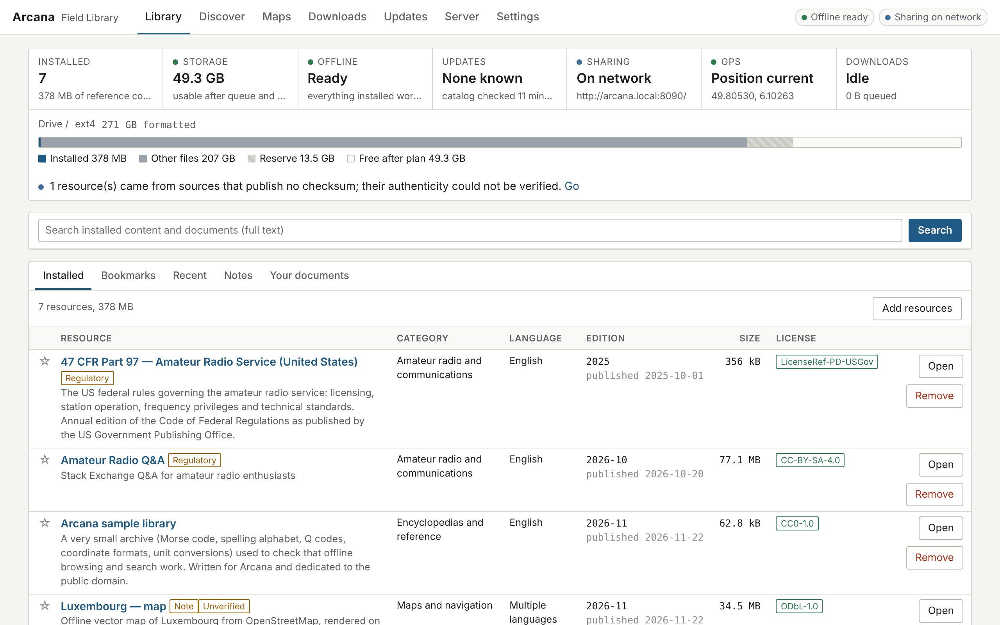
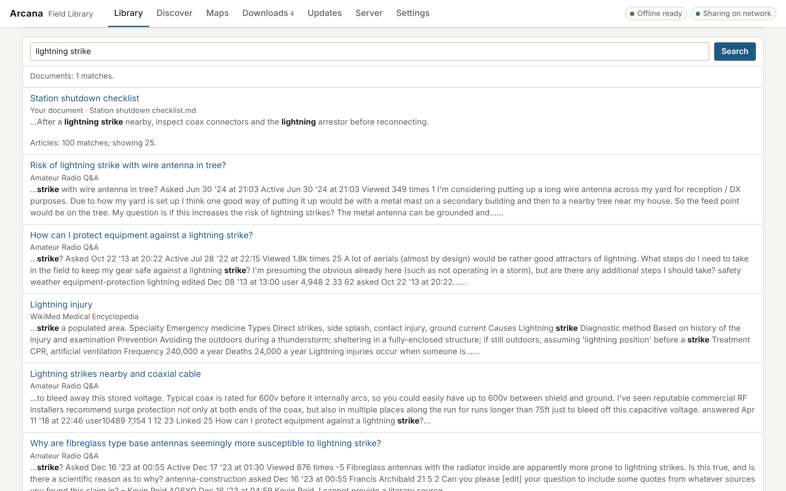
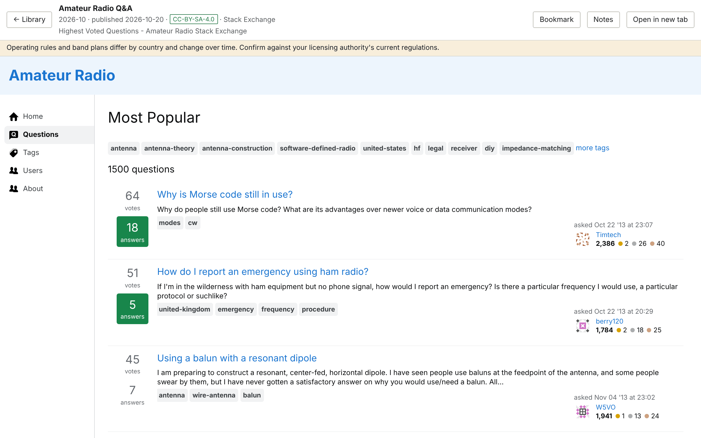
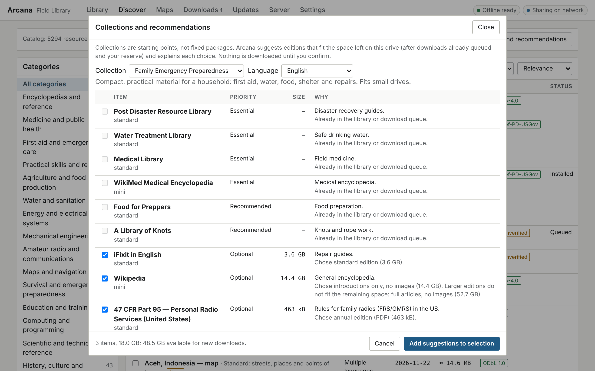
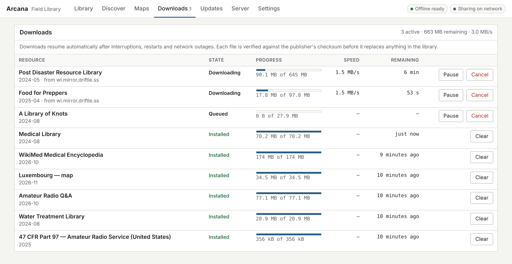
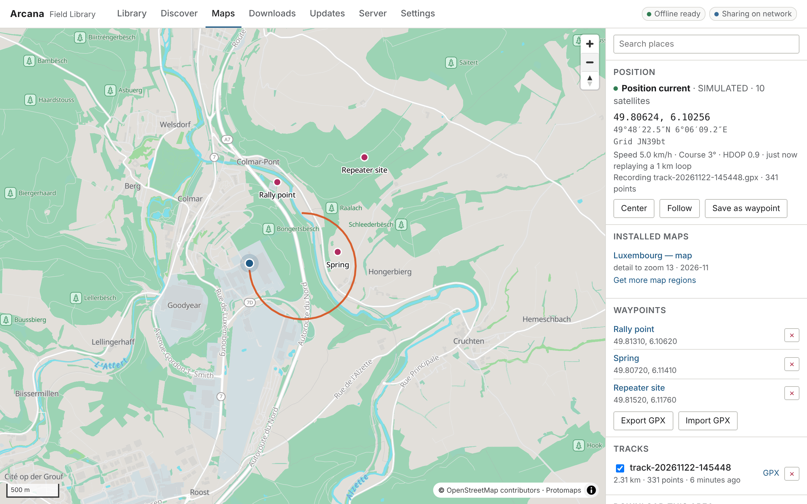
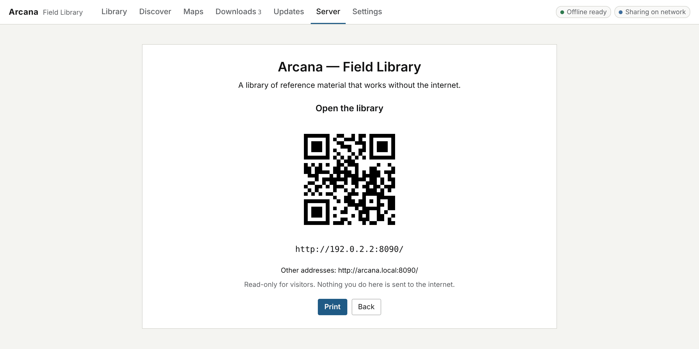
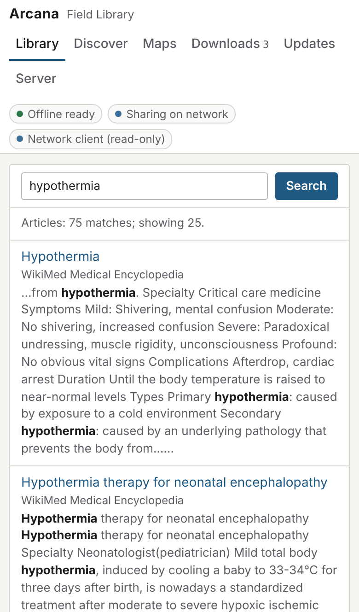
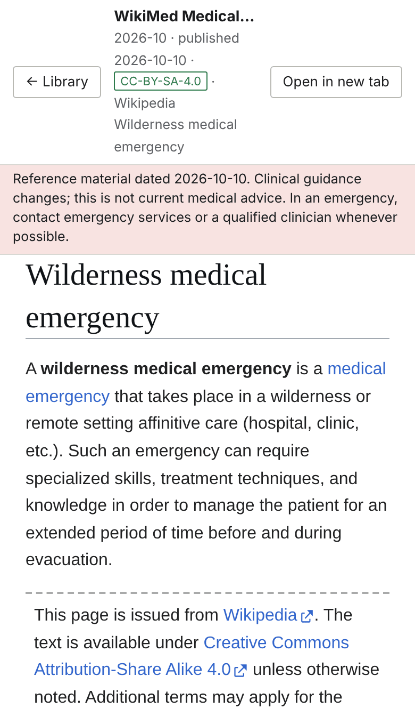

# Arcana

**A portable, offline-first knowledge library.** Arcana lets you build a
collection of reference material on an external drive: encyclopedias,
medical references, repair guides, amateur radio regulations and maps.
You can then carry the drive between computers and read, search and share
it with no internet connection.

> The ultimate design criterion is not how many features Arcana advertises,
> but whether you can depend on the information stored in it when
> everything else is offline.

<picture>
  <source media="(prefers-color-scheme: dark)" srcset="docs/screenshots/library-dark.png">
  
</picture>

Status: **0.7.0** ([changelog](CHANGELOG.md)). It
works end to end on Linux and is packaged for Windows and macOS, but **has
not yet been run on real Windows or macOS hardware**, and the programs are
not yet code-signed (see [Status](#status)).

## What it does today

- **Runs from the drive.** No installation and no administrator rights.
  `Arcana.exe` on Windows; `sh arcana.sh` on Linux and macOS (Intel and
  Apple Silicon; x86-64 and ARM64 Linux). Settings, downloads and indexes
  stay on the drive, which can change drive letter or mount point.
- **Knows the drive.** It shows capacity, file system and free space,
  explains why a "1 TB" drive shows 931 GiB, warns about FAT32's 4 GiB
  limit and NTFS being read-only on macOS, and keeps a reserve you choose.
- **Real catalog.** Over 3,600 offline archives from the Kiwix library
  (Wikipedia, WikiMed, Stack Exchange, iFixit, Project Gutenberg and more),
  541 map regions, Project Gutenberg's practical shelves (optional), a
  curated catalog and signed community catalogs. Licenses, redistribution
  status, publication dates and medical or regulatory warnings are shown
  for every resource.
- **Storage-aware selection.** Pick resources or start from nine
  collections ("Family Emergency Preparedness", "Amateur Radio Operator",
  …). Arcana recommends editions that fit your drive and explains each
  choice.
- **Downloads you can trust.**
  - Large files download in pieces from several mirrors at once, with
    most of the work going to whichever mirror is fastest for you.
  - Downloads resume after network failures, crashes and power loss, and
    retry across mirrors.
  - Every file is verified against the publisher's SHA-256 before it is
    used.
  - An update never removes the working version until the new one is
    verified.
- **Offline reading and search.** Archives open through Kiwix's reader,
  and PDFs and EPUBs in Arcana's own viewer. Search covers every installed
  archive and your own documents: matching titles first, then each
  source's best matches with its own count. The reader searches the open
  archive (titles complete as you type), and documents have a find bar.
  Provenance and warnings are shown above every page.
- **Ask questions of your library** (optional, off until you turn it on).
  Type a question in plain words; Arcana finds passages in your archives
  and documents and a language model writes a short answer from them,
  citing each passage with its edition, date and warnings. When nothing in
  the library covers the question it says so instead of guessing. The
  model runs on your computer through Mozilla.ai's llamafile (three openly
  licensed models from 0.5 to 2.5 GB in the catalog), or on an Ollama or
  LM Studio server you choose.
- **Medicines reference.** The labels of about 265,000 medicines sold in
  the US, from the FDA's openFDA downloads (public domain): search by name
  or ingredient, find non-prescription medicines by situation (fever,
  burns, diarrhea…), read a label's directions and warnings, and put two
  labels' warnings side by side. Arcana builds it on your computer from
  1.8 GB of downloads into about 1 GB.
- **Your own material.** Bookmarks, favorites, notes and reading history.
  Add your own PDF, EPUB, HTML, Markdown and text files; they are indexed
  and searched with everything else.
- **Offline maps, directions and GPS.** Vector maps of countries, states
  and continents from OpenStreetMap, or a custom area, with offline place
  search, distance and area measuring, and miles or kilometres. Directions
  by car, bicycle or on foot, with turn-by-turn guidance that follows the
  GPS and finds a new route when you leave it, from road networks Arcana
  builds from OpenStreetMap extracts (countries and states up to about
  1 GB of data). Position
  from a USB or serial GPS receiver, gpsd, NMEA over UDP/TCP, a simulator
  or a fixed point; waypoints, track recording and GPX import and export.
- **Share on the local network** (`--lan`). Phones and other computers can
  browse and search; only the host computer can make changes. Other
  devices find the library as `arcana.local` or by scanning a QR code.
  HTTPS and password-protected remote administration are optional.
- **Integrity tools.** Quick and full checks find missing or corrupted
  files. If the metadata index is lost, it is rebuilt from the drive.
- **Scheduled content updates** (optional, off by default). Choose hours
  (for example 01:00–06:00) and an interval; Arcana refreshes the catalogs,
  downloads newer editions that fit the drive (medical and regulatory
  first) under a bandwidth cap, and pauses those downloads outside the
  window.
- **Updates in one click.** Once a day, while online, Arcana looks for a
  new version. A banner offers *Update now*: the new version is
  verified against the project's signature, installed, and Arcana
  restarts into it. The previous version is kept for rollback. The check
  can be switched off in *Settings → Application updates*; it is the only
  network request Arcana makes without being asked.
- **Moving content without internet.** `arcana import` installs archives
  from another drive and verifies them against the catalog with no
  network. `arcana export` copies resources to another drive, and two
  Arcana libraries on the same network can copy from each other.
- **Raspberry Pi / Linux appliance.** An installer sets Arcana up as a
  service with its own Wi-Fi network and captive portal
  ([docs/appliance.md](docs/appliance.md); not yet run on hardware).
- **Integration API** for other programs, such as RadioPost and Aether HF:
  search with citations, article excerpts and position, with scoped tokens
  the operator approves ([docs/integration-api.md](docs/integration-api.md)).

## Screenshots

<table>
  <tr>
    <td width="50%" valign="top">
      <br>
      <b>Search</b> across every installed archive and your own documents at once.
    </td>
    <td width="50%" valign="top">
      <br>
      <b>Read</b> with the edition, license and any regulatory or medical notice above every page.
    </td>
  </tr>
  <tr>
    <td width="50%" valign="top">
      <br>
      <b>Collections</b> suggest editions that fit the space left on the drive, and say why.
    </td>
    <td width="50%" valign="top">
      <br>
      <b>Downloads</b> resume after interruptions and are verified before they are used.
    </td>
  </tr>
  <tr>
    <td width="50%" valign="top">
      <br>
      <b>Maps</b> with your position, waypoints and recorded tracks (here from the GPS simulator).
    </td>
    <td width="50%" valign="top">
      <br>
      <b>Share</b> on the local network: other devices scan the code or open <code>arcana.local</code>.
    </td>
  </tr>
  <tr>
    <td colspan="2" align="center">
      
      &nbsp;&nbsp;
      <br>
      <b>On a phone</b> over the local network: visitors can search and read but not change anything.
    </td>
  </tr>
</table>

<sub>Arcana 0.6 on Linux. Content shown: Amateur Radio Stack Exchange and
WikiMed (from Wikipedia), CC BY-SA 4.0. Map data © OpenStreetMap
contributors (ODbL), from the Protomaps basemap.</sub>

## Quick start (portable)

1. Download the [latest release](https://github.com/KK4ODA/arcana/releases/latest)
   and unzip the `Arcana` folder onto an external drive (exFAT
   recommended).
2. Start it:
   - **Windows:** double-click `Arcana.exe`.
   - **Linux / macOS:** `sh /path/to/Arcana/arcana.sh`
3. Your browser opens Arcana. Confirm where to create the library (the
   folder you unzipped is suggested). A small sample library is
   pre-installed, so you can check offline browsing and search immediately.
4. While online, open **Discover → Refresh catalog**, choose resources or a
   collection, and press **Download selected**.

More in [docs/portable-use.md](docs/portable-use.md), including first-run
security prompts (the binaries are not yet code-signed) and network sharing.

## Command line

```
arcana [serve] [--library DIR] [--port N] [--lan] [--no-browser] [--read-only]
arcana init DIR [--label NAME]
arcana status | volumes | version
arcana check [--full]
arcana catalog refresh | catalog search TEXT
arcana get RESOURCE-ID...                       # download, verify, install
arcana import FILE... [--id ID] [--allow-unverified]
arcana import --from DIR [ID...] [--user-documents]
arcana export --to DIR [ID...|--all] [--user-documents]
arcana manifest
arcana update stage DIR | apply | rollback | status
arcana hotspot start --ssid NAME --password PW [--device wlan0] | stop | status
arcana ask [--no-library] QUESTION | ask --eval FILE [--with-model]
```

`arcana --help` describes each command.

## Building from source

Requires Go 1.26+.

```
scripts/fetch-kiwix.sh          # hash-pinned kiwix-serve for your platform
go test ./...                   # unit and integration tests
make acceptance                 # offline acceptance test (Linux, network namespace)
go run ./cmd/arcana --library /tmp/lib   # opens setup if /tmp/lib is not a library yet
scripts/package.sh X.Y.Z        # portable bundle for all platforms → dist/
```

See [docs/development.md](docs/development.md).

## Status

| | |
|---|---|
| **Implemented and tested** | Portable library layout; drive detection (Linux tested; Windows and macOS code compiled); capacity planning; catalog (bundled, Kiwix OPDS, feeds); recommender; verified resumable downloads; offline import; ZIM reading and search via kiwix-serve; web UI; read-only LAN sharing; integrity check; offline acceptance test |
| **Built, not yet run on hardware** | Windows `Arcana.exe`, macOS binaries, Linux ARM64 |
| **Implemented (Phase 2)** | Bookmarks, favorites, history and notes; your own documents with full-text search (PDF, EPUB, HTML, Markdown, text); drive-to-drive collection transfer; signed application updates with rollback; Project Gutenberg provider |
| **Implemented (Phase 3)** | Offline vector maps: 541 OpenStreetMap regions (world, continents, countries, states) extracted on demand from Protomaps planet builds, custom areas, seamless merging of overlapping maps, offline place search; GPS from USB/serial receivers, gpsd, NMEA over UDP/TCP, a GPX simulator or a fixed position; waypoints, track recording, GPX import/export; distance and area measuring; offline directions and turn-by-turn navigation (car, bicycle, foot) from road networks built on the user's computer |
| **Implemented (Phase 4)** | `arcana.local` on the network (built-in mDNS), QR codes and a printable connection card, optional HTTPS on the same port, password-protected remote administration (off by default), Wi-Fi hotspot control on Linux |
| **Implemented (Phase 5), not yet run on hardware** | Raspberry Pi / Linux appliance: installer, confined systemd service with watchdog, Wi-Fi access point with captive portal ([docs/appliance.md](docs/appliance.md)) |
| **Implemented (Phase 6)** | Integration API for other programs (RadioPost, Aether HF) with scoped, approved tokens and citations ([docs/integration-api.md](docs/integration-api.md)); copying between Arcana libraries on a LAN; signed community catalogs |
| **Implemented (unreleased)** | Question answering over installed sources with citations, a relevance floor and an evaluation set; llamafile sidecar or an OpenAI-compatible server ([ADR-0021](docs/adr/0021-question-answering-over-the-library.md)). Not yet measured on a Raspberry Pi or with a real model in CI |
| **Planned** | Ready-made Raspberry Pi SD image; hardware and power-loss tests. Terrain and contours; road networks for the largest countries; scheduled peer sync |
| **Not yet** | Code-signed programs (releases are not code-signed yet; Windows and macOS warn on first start) |

The full design package is in [docs/](docs/README.md).

## License

Arcana is licensed under the GNU General Public License v3.0 or later. It
runs [kiwix-serve](https://github.com/kiwix/kiwix-tools) (GPL-3.0-or-later)
as a separate program. Third-party components are listed in
[THIRD_PARTY_NOTICES.md](THIRD_PARTY_NOTICES.md). Reference content is
licensed by its publishers; Arcana shows each resource's license.

Arcana is not a source of current medical advice. Medical references are
dated reference material; in an emergency, contact emergency services or a
qualified clinician whenever possible.
