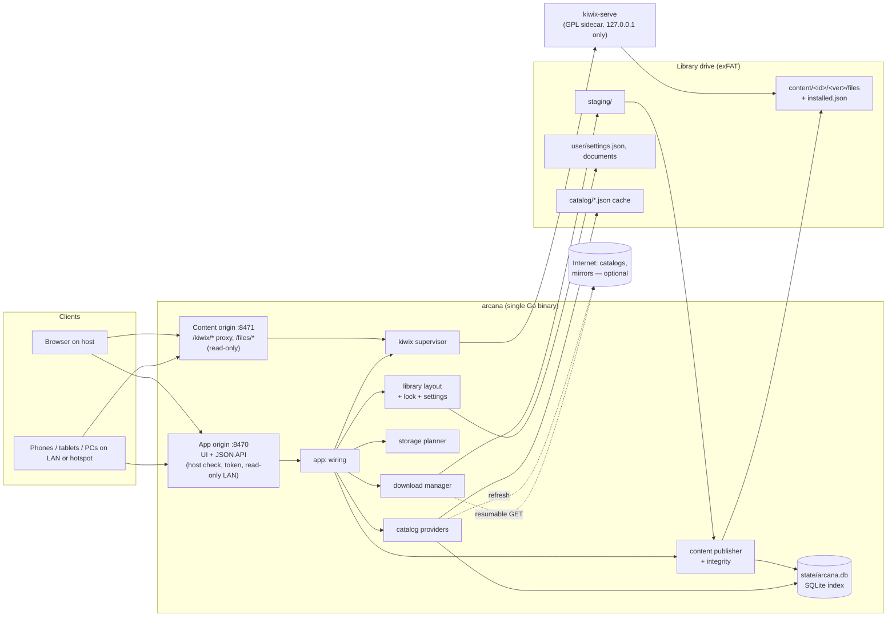

# B. Architecture

## Requirements that drive the architecture

1. **Offline is non-negotiable.** Nothing used at runtime may come from the
   internet: no CDN scripts, fonts, map styles or authentication.
2. **One drive, many hosts.** The same library must work on a Windows
   laptop, a Linux mini PC, a Mac and a Raspberry Pi without conversion.
3. **Ordinary users.** Double-click to start. No installer, Docker, Python
   environment or administrator rights.
4. **Browser clients are mandatory.** Phones and tablets on the LAN or the
   appliance hotspot can only use a browser, so a web UI is required no
   matter what the desktop shell is.
5. **Adverse conditions.** Drives get unplugged mid-write, power fails,
   networks drop for hours, and files get corrupted.

## Options evaluated

| Criterion | A. Tauri (Rust + web UI) | B. Python backend + desktop shell | C. Qt native (C++/QML) | **D. Single Go binary: local HTTP server + browser UI** |
|---|---|---|---|---|
| Win/Linux/macOS | Yes; needs WebView2 (Win) / WebKitGTK (Linux) present on host | Yes, via PyInstaller per OS | Yes | Yes; static binaries cross-compiled from one machine |
| Portable from a drive | Possible; WebKitGTK is not guaranteed on Linux hosts | Large one-folder bundles, slow start from USB, AV false positives | Large Qt runtime per OS (~60–100 MB) | One ~12.5 MB file per OS, no runtime dependencies |
| ARM64 / Pi | Yes (build per target) | Yes, but heavy | Yes, but heavy | Yes (`GOARCH=arm64`), no cgo |
| Headless appliance | Shell unused; still need a web server | Same | Needs separate web UI | Same binary is the appliance server |
| LAN/phone clients | Needs a second, web-only UI path | Same | Needs separate web UI | **One UI for desktop, LAN and appliance** |
| Startup / memory | Fast / low | Slow / medium-high | Fast / medium | **281 ms to ready, 43 MB RSS (measured)** |
| HTTP serving | Add a Rust server | Good (FastAPI) | Add a server | Excellent stdlib server |
| Serial / GPS | Good crates | pyserial / pynmea2 | QtSerialPort | go.bug.st/serial, go-nmea |
| Downloads / hashing | Good | Adequate | Good | Excellent (stdlib HTTP, resumable hash state) |
| SQLite | rusqlite (C) | sqlite3 (C) | Qt SQL | modernc.org/sqlite (pure Go, FTS5) |
| Build/release | Per-OS toolchains, signing per OS | PyInstaller per OS on each OS | Per-OS Qt toolchains | `GOOS/GOARCH` matrix on one Linux runner |
| Contributor barrier | Rust learning curve | Low | High | Low–medium |
| Security surface | WebView + Rust | Large dependency tree | C++ memory safety | Memory-safe, small dependency tree (9 modules) |

**Recommendation: D.** A single Go binary per platform runs an embedded HTTP
server and opens the system browser. The same binary is the portable
desktop application, the LAN server and the appliance service. Kiwix's
kiwix-serve runs beside it as a supervised sidecar process. See
[ADR-0002](../adr/0002-single-go-binary-local-web-app.md) and
[ADR-0003](../adr/0003-kiwix-serve-sidecar.md).

**Accepted tradeoffs**
- The UI looks like a web page rather than native widgets.
- Closing the browser tab does not stop Arcana; the console window or a
  future tray icon does.
- An optional native window (system WebView) can be added later without
  changing the architecture.

## System diagram

## Module boundaries

Each module is a Go package with one responsibility and a narrow interface.
Dependencies point downward; nothing below `app` imports `app` or `server`.

| Package | Responsibility | Depends on |
|---|---|---|
| `cmd/arcana` | CLI, launcher behavior, signals, browser launch | app, server |
| `internal/server` | HTTP listeners, routing, access policy, JSON API, static UI | app, web |
| `internal/web` | Embedded UI assets (no build step, no external URLs) | — |
| `internal/app` | Wires modules for one library; catalog refresh; storage report; updates; import | all below |
| `internal/catalog` | Resource model, validation, providers (bundled, Kiwix OPDS, feeds), metalinks, presets, recommender | storage, fsutil |
| `internal/download` | Persistent queue, resumable verified transfers, safe HTTP client | store, content, storage, library |
| `internal/content` | Publish/remove resources, sidecars, integrity check, garbage collection | store, library, fsutil |
| `internal/kiwix` | kiwix-serve discovery, supervision, proxy, search federation | buildinfo |
| `internal/store` | SQLite schema, migrations, queries (index only) | catalog |
| `internal/storage` | Volume detection per OS, file-system rules, capacity plan | — |
| `internal/library` | Layout, marker, discovery, lock, settings | fsutil |
| `internal/fsutil` | Atomic writes, safe paths, OS locks | — |

Planned modules use the same boundaries:

| Package | Phase | Purpose |
|---|---|---|
| `internal/maps` | 3 | PMTiles reader/server, style/glyph/sprite assets, region catalog |
| `internal/gps` | 3 | Sources (serial, UDP, TCP, gpsd, GPX playback, manual), NMEA parsing, fix state, SSE fan-out |
| `internal/userdata` | 2 | Bookmarks, notes and documents (`user/`), FTS5 index |
| `internal/transfer` | 2 | Collection export/import between drives, portable manifest |
| `internal/appupdate` | 2 | Signed release manifests, staged application updates |
| `internal/discovery` | 4 | mDNS advertisement, QR codes |
| `internal/integration` | 6 | Versioned local API for RadioPost, Aether HF and others |

## Runtime behavior

- **Start.**
  1. Find the library: `--library`, then `ARCANA_LIBRARY`, then the
     executable's folder and its parents, then the working directory.
  2. If no library is found, serve a setup page that lists drives.
  3. Take the OS lock. If another Arcana process holds it, open read-only.
  4. Open the database, recovering it if damaged.
  5. Re-index installed resources from their sidecars.
  6. Import catalog caches.
  7. Start the download queue, recovering interrupted jobs.
  8. Start kiwix-serve and open the browser.
- **Stop (Ctrl+C, window close, SIGTERM).**
  1. Downloads checkpoint and stop.
  2. kiwix-serve is killed.
  3. The WAL is checkpointed into the main database file.
- **Crash or power loss.** Nothing is lost beyond the last download
  checkpoint (16 MiB). kiwix-serve exits by itself through
  `--attachToProcess`.

## Answers to the design questions

1. **Desktop program with embedded server, or local web app with launcher?**
   A local web app whose launcher *is* the server (one binary). Every mode
   needs a browser UI anyway; a native shell would duplicate it. An
   optional WebView window can be added later.
2. **How do binaries for different OSes coexist?** Each program lives in
   `bin/<os>-<arch>/` next to its own kiwix-serve. `Arcana.exe` sits at the
   top level for Windows users, and `arcana.sh` picks the right Linux or
   macOS binary. Content and metadata are shared and platform-neutral
   (forward-slash relative paths, UTF-8, lower-case IDs safe on Windows).
3. **Best common file system?** **exFAT**: native read/write on Windows,
   macOS and Linux 5.7+, and no 4 GiB limit. It has no journal, which Arcana
   compensates for (ADR-0006). NTFS is read-only on macOS; FAT32 cannot hold
   most archives; ext4 is suitable for a dedicated appliance drive.
4. **Can Kiwix provide most content rendering?** Yes, for ZIM: rendering,
   per-archive and same-language multi-archive search, and the catalog. Not
   for PDFs/EPUB, user documents, cross-language unified search or maps;
   Arcana adds those.
5. **Provider-independent catalog?** A normalized `Resource` model with
   strict validation and pluggable providers. Kiwix OPDS, Arcana JSON feeds
   and the bundled catalog exist today; Gutenberg, PMTiles regions and
   government document lists come later. Each provider owns its ID
   namespace. See [03-catalog.md](03-catalog.md).
6. **Map format?** **PMTiles**: a single file, range-readable, deduplicated,
   portable and easy to extract by region (ADR-0008). MBTiles only where
   in-place updates matter.
7. **Render maps on host or client?** **On the client** with MapLibre GL JS
   (vector tiles). The host only serves byte ranges, which scales to many
   clients and a Pi. A raster fallback for very old devices is evaluated
   in Phase 3.
8. **Sharing GPS with browser clients securely?** The server reads GPS and
   pushes fixes over one Server-Sent Events stream per tab (read-only,
   rate-limited, no write path). Browser geolocation is unavailable over
   plain-HTTP LAN origins, so phones push NMEA to the server instead. See
   [05-maps-gps.md](05-maps-gps.md).
9. **What needs privileges?**
   - **No privileges:** reading, downloading, LAN serving on ports ≥ 1024,
     serial ports (a user-group membership on Linux), and binding UDP/TCP
     GPS ports ≥ 1024.
   - **Needs privileges:**
     - Creating a Wi-Fi hotspot: admin or polkit on Linux; the Windows
       hotspot needs an upstream connection profile; macOS has no API.
     - Captive portal DNS/DHCP on ports 53/67.
     - Binding port 80.
     - Changing firewall rules.
   - Arcana keeps all of these in the appliance's system service and
     documented scripts, never in the portable app (ADR-0010).
10. **Application updates on removable drives?**
    1. Download a signed release manifest and the per-platform binaries
       into `staging/`.
    2. Verify them, then swap `bin/<platform>/` atomically and keep the
       previous version for rollback.
    3. An update package copied from another drive installs offline the
       same way.
    4. Updates are never automatic and never required (ADR-0011).
11. **Licensing and provenance?** Every resource records its license, its
    redistribution status (permitted / non-commercial / restricted /
    unknown), whether that was verified, publisher, source URL, version,
    publication date, the hash source and the installation verification
    result. This is stored in the sidecar on the drive, so provenance
    travels with the content.
12. **User documents never overwritten?** Content operations only touch
    `content/<id>/` and `staging/`. User data lives in `user/`, a separate
    tree that no installer, updater or garbage collector writes to.
    Settings preserve keys written by newer versions.
13. **Same drive on Windows and a Linux appliance?**
    - The drive carries `bin/` for all platforms.
    - Paths are relative with forward slashes; names are validated as
      portable (no reserved Windows names, no `:`).
    - The database is a rebuildable cache.
    - The library format is versioned and newer formats open read-only.
    - The exFAT recommendation keeps both sides writable. The acceptance
      test moves a library between mount points.
14. **Smallest useful first release?** Phase 1, as implemented: portable
    launch, drive detection and capacity planning, a real catalog (Kiwix +
    curated), verified resumable downloads, offline import, ZIM browsing and
    search, integrity checks, and read-only LAN sharing. It is useful on
    its own as a "Kiwix library manager that does not lose data", and every
    later phase plugs into the same module boundaries.
