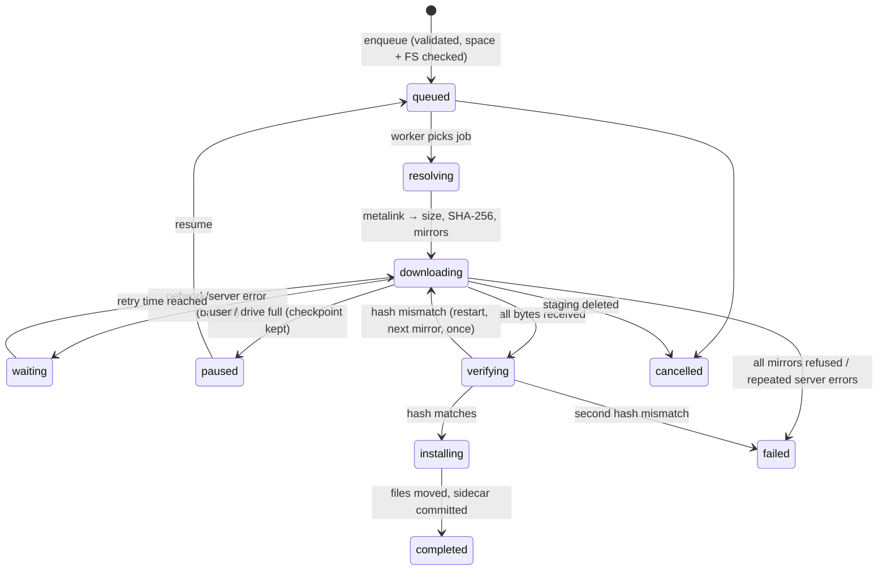

# C. Resource catalog specification

## Principles

- **Providers, not URL lists.** Every source of resources is a *provider*
  that converts its own format into Arcana's normalized `Resource` model.
- **Untrusted input.** Provider output is validated before it reaches the
  database, the download manager or the file system. A hostile catalog
  cannot choose paths, use non-HTTP URLs, claim another provider's
  identifiers, inject markup, or assert redistribution rights without a
  verified license record.
- **Offline-first.** The bundled catalog is compiled into the binary. Each
  remote provider's last good result is cached on the drive
  (`catalog/<provider>.json`), so a library prepared online can be browsed
  and planned offline.
- **Version-aware.** `id` names the resource across editions; `version`
  names an edition. Updates are newer versions of the same `id`. `family`
  groups alternative editions (full, no images, introductions only).

## Resource model

The schema is [docs/spec/catalog-feed.schema.json](../spec/catalog-feed.schema.json);
the Go type is `catalog.Resource`.

| Field | Meaning | Validation |
|---|---|---|
| `id` | Stable identifier, `<provider>.<name>` | `^[a-z0-9]+(\.[a-z0-9][a-z0-9._-]*)?$`, ≤128 chars, must be a portable directory name (no Windows device names), prefix must equal `provider` |
| `provider` | Namespace that published the entry | Forced to the configured provider ID; feeds cannot choose it |
| `title`, `description` | Display text | Control characters stripped, length-capped, always rendered as text |
| `category`, `subcategory` | One of 18 categories (extensible) | Unknown values fall back to `reference` |
| `family`, `variant`, `variantLabel` | Alternative editions | — |
| `publisher`, `creator`, `sourceUrl` | Provenance | URLs must be `http(s)` without credentials |
| `version` | Edition (`2026-10`, `1.4.2`, `2026-11a`) | `^[A-Za-z0-9][A-Za-z0-9._-]{0,63}$` |
| `published` | Content date | — |
| `lastVerified` | When the entry was last confirmed against its source | — |
| `languages` | BCP 47 tags; ISO 639-3 converted to 639-1 when possible | Pattern-checked |
| `coverage` | `{scope: global\|regional\|none, regions: ["US","US-VA"], bbox}` | bbox has exactly 4 numbers |
| `format` | `zim`, `pdf`, `epub`, `html`, `markdown`, `text`, `image`, `audio`, `video`, `pmtiles`, `mbtiles`, `gpx`, `archive` | Allow-list |
| `files[]` | `{name, size, hashes{sha256,sha512,sha1,md5}, mirrors[{url,priority,location}], metalinkUrl}` | Name is one safe path component; hashes are hex of the right length; at least one location |
| `downloadSize`, `installedSize`, `sizeEstimated` | Planning sizes | ≤ 64 TB |
| `license` | `{id (SPDX), name, url, redistribution, attribution, verified, notes}` | `redistribution` ∈ permitted / noncommercial / restricted / unknown; `permitted` downgraded to `unknown` unless `verified` |
| `capabilities` | `{fullTextSearch, titleSearch}` | — |
| `media` | `{pictures, videos, detail: full\|reduced\|summary}` | — |
| `dependencies` | Resource IDs required alongside | ID pattern |
| `updateStrategy` | `snapshot-replace` (default) or `none`; `delta` reserved | — |
| `warnings[]` | `{kind: medical\|regulatory\|outdated\|license\|content, text}` | Text cleaned |
| `stats`, `popularity` | Counts (articles, media) and a provider rank | — |
| `providerRef` | Provider-private data (e.g. ZIM UUID) | — |

### Automatic warnings

- **Medical / first aid:** "Reference material dated YYYY-MM-DD. Clinical
  guidance changes; this is not current medical advice. In an emergency,
  contact emergency services or a qualified clinician whenever possible."
  This is shown in the catalog, the library list and above every page in
  the reader.
- **Amateur radio / regulations:** the jurisdiction and edition date, plus a
  reminder to confirm against the current rules.
- **Outdated:** published three or more years ago.

## Provider interfaces

```go
type Provider interface {
    ID() string                                  // namespace for resource IDs
    Name() string
    Fetch(ctx context.Context, f Fetcher) ([]Resource, error)
}

// Optional: refine an entry just before download (exact size, hashes, mirrors).
type Resolver interface {
    Resolve(ctx context.Context, f Fetcher, r Resource) (Resource, error)
}

// Bounded GET: every catalog read has a size cap.
type Fetcher interface {
    Get(ctx context.Context, url string, maxBytes int64) ([]byte, error)
}
```

### Implemented providers

| Provider | Source | Notes |
|---|---|---|
| `arcana` (bundled) | `internal/catalog/bundled/catalog.json`, compiled in | Curated, license-verified entries with SHA-256: the sample library, 47 CFR Parts 95 and 97, U.S. Army manuals, the assistant and translation engines, Kolibri, and 13 public-domain feature films (ADR-0027) |
| `kiwix` | `library.kiwix.org/catalog/v2/entries` (OPDS v2, paginated) | 3,682 entries on 2026-11-22, all accepted by validation. Maps Kiwix categories and names to Arcana's 16 categories, assigns reviewed licenses per family, adds warnings. Resolves `.meta4` at download for exact size, SHA-256 and geo-ranked mirrors |
| `gutenberg` (opt-in) | `pg_catalog.csv.gz` from the official mirror (gutenberg.pglaf.org) | 6,572 practical titles (health, farming, cooking, engineering, crafts, sciences, scouting) mapped to categories; EPUB downloads from the mirror; no checksums published, so installs are marked unverified; historical medical books carry an "obsolete or dangerous" warning |
| feeds (user-added) | Any URL serving an Arcana feed | Namespace = the ID the user gives the feed; may use metalinks |

### Planned providers

| Provider | Phase | Source |
|---|---|---|
| `maps` | 3 | Protomaps daily builds, extracted to PMTiles by region and zoom (see 05-maps-gps.md), or prebuilt regional extracts |
| `govdocs` | 2 | Curated public-domain US government publications (FEMA, CDC, NOAA, govinfo CFR), hashed at curation time |
| `local` | 2 | A folder or drive containing an Arcana export (offline transfer) |
| `kolibri` | 6 | Kolibri channels, optional |

## Feed format (for community and user catalogs)

```json
{
  "format": "arcana-catalog",
  "formatVersion": 1,
  "title": "Example community catalog",
  "generated": "2026-11-22T00:00:00Z",
  "resources": [
    {
      "id": "community.water-treatment-guide",
      "provider": "community",
      "title": "Household Water Treatment Guide",
      "description": "Boiling, filtration and chemical disinfection.",
      "category": "water-sanitation",
      "version": "2024",
      "published": "2024-05-01",
      "languages": ["en"],
      "coverage": {"scope": "global"},
      "format": "pdf",
      "files": [{
        "name": "water-treatment-2024.pdf",
        "size": 2483021,
        "hashes": {"sha256": "…64 hex characters…"},
        "mirrors": [{"url": "https://example.org/water-treatment-2024.pdf"}]
      }],
      "license": {"id": "CC-BY-4.0", "redistribution": "permitted", "verified": true,
                  "url": "https://creativecommons.org/licenses/by/4.0/"},
      "updateStrategy": "snapshot-replace"
    }
  ]
}
```

**Signed feeds (0.6.0).** A publisher can sign a feed so that a mirror or
network attacker cannot alter it. The publisher keeps an Ed25519 key
(`go run ./tools/release-sign keygen -out feed.key` prints the public key)
and publishes `catalog.json.sig` next to `catalog.json`
(`go run ./tools/release-sign sign -in catalog.json`). Users add the feed
with the public key; Arcana then rejects the feed if the signature is
missing or does not match the exact bytes. Unsigned feeds still work
without a key. Signing proves who published the catalog; it does not
replace the per-file SHA-256 checksums the catalog lists.

A Kiwix entry after normalization (abbreviated):

```json
{
  "id": "kiwix.wikipedia_en_medicine_nopic",
  "provider": "kiwix",
  "title": "WikiMed Medical Encyclopedia",
  "category": "medicine",
  "family": "kiwix.wikipedia_en_medicine", "variant": "nopic",
  "variantLabel": "Full articles, no images",
  "version": "2026-10", "published": "2026-10-10",
  "languages": ["en"], "format": "zim",
  "files": [{"name": "wikipedia_en_medicine_nopic_2026-10.zim",
             "metalinkUrl": "https://lb.download.kiwix.org/zim/wikipedia/wikipedia_en_medicine_nopic_2026-10.zim.meta4"}],
  "downloadSize": 1048000000,
  "license": {"id": "CC-BY-SA-4.0", "redistribution": "permitted", "verified": true},
  "capabilities": {"fullTextSearch": true, "titleSearch": true},
  "warnings": [{"kind": "medical", "text": "Reference material dated 2026-10-10. …"}],
  "providerRef": {"uuid": "…", "name": "wikipedia_en_medicine", "flavour": "nopic"}
}
```

## Presets and recommendations

Presets (`bundled/presets.json`) list resource **families** with the
curator's preferred editions (most detailed first), a priority (1
essential, 2 recommended, 3 optional) and a reason. `{lang}` in a family
name is replaced with the chosen language, falling back to English with an
explanation. Ten presets ship:

- Essential Knowledge
- Family Emergency Preparedness
- Amateur Radio Operator
- Medical and Public Health
- Field Technician
- Remote Expedition
- Education and Learning
- Community Knowledge Server
- Comprehensive Reference Library
- Films and Games

The recommender (`catalog.Recommend`) is a pure function. Its budget is the
planner's headroom: free space after queued downloads and the reserve. It
works tier by tier:

1. Include every essential item at its **smallest** acceptable edition.
2. Upgrade essential items toward the curator's preferred edition while
   space allows.
3. Repeat steps 1 and 2 for recommended items, then optional ones.

It reports a decision for every item: selected, already present, skipped
(with the size that did not fit) or unavailable (not in the catalog). It
also lists the alternatives. Nothing is queued until the user confirms, and
the user can change every choice. Tested outcomes:

- A 20 GB budget picks Wikipedia "introductions only" and skips the
  dictionary.
- 115 GB picks "full articles, no images" plus the dictionary.
- 2 TB picks every full edition.

## Download and update model



1. **Enqueue.**
   - The resource is re-validated.
   - Every file must fit the volume's per-file limit (FAT32's 4 GiB).
   - Free space minus space promised to other jobs must cover the download
     and the reserve.
   - If a different version is installed, the job records that it replaces
     it.
2. **Resolve.**
   - Providers with metalinks supply the authoritative size, SHA-256 and
     mirror list.
   - Resolution is persisted, so a restart does not need the network to
     know the expected hash.
3. **Transfer.**
   - The file goes to `staging/<job>/<file>.part` with
     `Accept-Encoding: identity`.
   - Every 16 MiB (or 10 s) the file is fsynced, then the byte offset and
     the *serialized SHA-256 state* are committed to SQLite.
   - On restart the partial file is truncated to the checkpoint and
     hashing resumes from the saved state: 100 GB is never re-read.
4. **Resume.**
   - `Range: bytes=N-`.
   - With a publisher hash, Arcana resumes against any mirror, since the
     final hash proves correctness.
   - Without one, it resumes only with a strong ETag or Last-Modified via
     `If-Range`, and otherwise restarts.
   - A `200` reply to a range request means the server ignored it or the
     file changed: start over.
   - Size mismatches against the catalog reject the mirror.
5. **Retry.**
   - Network failures are retried indefinitely with jittered exponential
     backoff (2 s → 5 min cap), so a queue resumes by itself when
     connectivity returns.
   - Server errors are retried up to 8 times.
   - 4xx responses mark a mirror bad for that job.
   - A stalled transfer (90 s without data) is aborted and retried.
6. **Verify.** The strongest published hash must match. SHA-256 is always
   computed and recorded for future integrity checks. Sources without a
   hash are installed only with an explicit "unverified" flag, shown in the
   UI.
7. **Publish (atomic).**
   1. Rename into `content/<id>/<version>/` (same volume).
   2. Write `installed.json` atomically. This is the commit point.
   3. Update the index.
   4. Reload kiwix-serve with a new process, so file handles are released.
   5. Only then delete the previous version.
   - A crash at any step leaves either the old version or the new one,
     never neither.
8. **Space safety.** Space is re-checked at every checkpoint. Reaching the
   reserve, or "disk full", pauses the job with its checkpoint intact.
9. **Updates.**
   - The Updates view compares installed versions with the last refreshed
     catalog. This works offline, and the last check time and errors stay
     visible.
   - Medical and regulatory updates are marked high priority.
   - Updates use the same pipeline, so a working version is never removed
     before its replacement is verified.
   - Delta updates: ZIM has no delta format in production. zimdiff and
     zimpatch exist in zim-tools but Kiwix does not publish diffs. Arcana
     reserves `updateStrategy: delta` for providers that offer it; PMTiles
     regional re-extraction is a candidate in Phase 3.
10. **Offline import.**
    - `arcana import FILE` matches a file to a catalog entry by name,
      verifies it against the catalog's SHA-256, copies it (never moves
      it) and publishes it.
    - Collection export/import with a portable manifest is Phase 2 (see
      09-storage-and-data.md).
