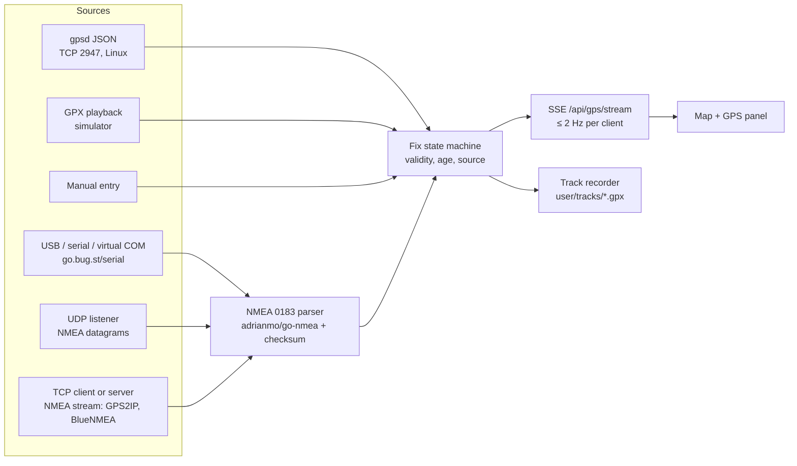

# E. Offline mapping and GPS design

Status: **Phase 3 implemented** (0.3.0). The table below lists what was
built, what differs from the design that follows, and what remains. The
rest of this document is the original design, kept for reference.

## Implementation status (Phase 3)

| Area | Status | Notes |
|---|---|---|
| PMTiles v3 reader and writer | Implemented | `internal/maps`: header, varint directories, Hilbert tile IDs, leaf directories, LRU leaf cache. No go-pmtiles dependency. |
| Region catalog | Implemented | 541 regions (world, 6 continents, 241 countries, 293 states/provinces) generated by `tools/map-regions` from Natural Earth boundaries (public domain). Sizes are **measured** from the directories of planet build 20261121, not estimated by a dry run. Levels: world z6/z7, continents z8/z10, countries and subdivisions z10/z13/z15 (z15 omitted where the plan exceeds 40 M tiles). Bundled in the binary, so regions are browsable offline. |
| Region download | Implemented, **differs** | Instead of maintainer-published extracts with SHA-256, Arcana extracts each region itself from the newest Protomaps planet build using HTTP range requests (`maps.Install` via the download manager's extractor hook). The output layout is computed before any tile data is fetched and tiles stream straight into the final file. Interrupted extractions resume from a checkpoint while the source ETag is unchanged; a changed or deleted build restarts from the newest build. The plan is cached next to the partial file, so a resume does not fetch directories again. Integrity: every response must carry the ETag seen first, the result must open as a valid archive, and its SHA-256 is recorded for later checks. Because no publisher checksum exists, map installs are labelled **unverified**, as the design anticipated. |
| Custom area | Implemented | Map view → "Download this area": measures the visible area against the newest build (directories only), shows the exact size, then queues it. Zoom 6–15, at most 6 M tile positions per plan. |
| Tile serving | Implemented | `/maps/tiles/{z}/{x}/{y}.mvt` serves one merged pyramid from every installed map: the most detailed set covering a tile answers. Where no set has a tile, it is **derived from the nearest ancestor** (up to 10 levels) by scaling and clipping its geometry (ADR-0015), so a world overview fills areas outside a detailed country. |
| Renderer | Implemented, **differs** | MapLibre GL JS **5.24.1** CSP build (vendored), not v6: v6 was not released when this was built. MapLibre 5 needs WebGL2; there is no WebGL1 or raster fallback yet (unresolved). |
| Style, glyphs, sprites | Implemented | Protomaps basemaps 5.7.2 light and dark layers (generated by `tools/fetch-map-assets.sh`), Noto Sans Regular/Medium/Italic glyphs for Latin, Greek, Cyrillic and more (OFL), sprites v4. Missing glyph ranges are answered with an empty set; CJK is drawn by the browser's own fonts. |
| Place search | Implemented | SQLite FTS5 gazetteer built from the `places` layer at z12 (or the map's maximum zoom) when a map is installed; overlapping maps are de-duplicated. A country indexes in well under a second. |
| Coordinates | Partly | Decimal degrees, DMS and Maidenhead locator. DDM and MGRS/UTM are not implemented. |
| Waypoints | Implemented, **differs** | Stored in `user/waypoints.json` (not GeoJSON under `user/maps/`). |
| GPX import/export | Implemented | GPX 1.1 waypoints, routes (imported as tracks) and tracks; coordinates range-checked; 64 MB limit. |
| Track recording | Implemented | `user/tracks/track-*.gpx`, 5 m minimum spacing, new segment after a 60 s gap, rewritten atomically at most every 30 s. |
| Distance and bearing tools | Not implemented | Great-circle functions exist (`gps.Distance`, `gps.Bearing`) but there is no measuring tool in the UI yet. |
| Terrain, contours, emergency overlays | Not implemented | |
| Routing | Not implemented | Valhalla/BRouter evaluation remains Phase 3c. |
| GPS sources | Implemented, **differs** | Serial (go.bug.st/serial), UDP listener, TCP client, gpsd, simulator, manual. gpsd is read in **NMEA watch mode** so every source shares one parser. The simulator generates real RMC/GGA sentences from a GPX track (or a 1 km loop on the installed map) and labels its fixes "simulated". Not implemented: TCP server mode, baud-rate autodetection, the UDP sender allow-list and rate limit; UDP listens on every interface once chosen (the help text says so). |
| Fix states | Implemented | off, connecting, waiting (connected, no data), searching (data, no fix), current (≤ 5 s), stale (≤ 60 s), lost, manual, error. Sentences with status V, quality 0 or a bad checksum never move the position. An empty altitude field means unknown, not sea level. |
| Live updates | Implemented | Server-sent events at `/api/gps/stream`, at most 2 per second plus a 5 s heartbeat so freshness changes are visible. |
| Privacy | Implemented | Position, waypoints and tracks are visible to network clients only when "Share position" is on (off by default). Arcana never transmits positions. |
| Tests | Implemented | Unit tests for the tracker (real receiver sentences, no-fix sentences, round-tripped generated sentences), UDP, TCP and gpsd sources against local servers, the simulator, staleness, waypoints and GPX; the offline acceptance test installs a map, finds a place, serves native and derived tiles, runs the simulator and a UDP receiver, and checks that LAN clients cannot see the position. |
| Hardware | Not run | No physical receiver has been connected yet. Serial enumeration on macOS without cgo lists `/dev` names only. |

## Map data format

| Option | Strengths | Weaknesses | Decision |
|---|---|---|---|
| **PMTiles v3** (spec CC0, BSD-3 tools) | Single file; HTTP range-readable; deduplicated (often 70 %+ smaller than MBTiles for basemaps); extract by bbox or polygon from the daily planet build with range requests | Read-only (re-extract to update) | **Primary format** |
| MBTiles 1.3 (SQLite) | In-place updates; ubiquitous tooling | Larger; needs a SQLite reader on the server; no direct HTTP range access | Supported for imports and user-made overlays |
| OSM `.osm.pbf` (Geofabrik) | Source data for routing/geocoding | Not renderable directly | Used only as build input for routing/geocoding packs |
| Raster tiles | Works on very old devices | 5–20× larger | Fallback only, small extents |

**Basemap.** The Protomaps basemap (schema v4; code BSD-3, design CC0) with
glyphs from `basemaps-assets` (Noto, OFL) and sprites (MIT). This avoids
OpenMapTiles' mandatory visible credit, though OSM attribution is still
required. The style, glyph PBFs and sprites are vendored in the binary or
installed as an "assets" resource; nothing is fetched at runtime.

**Data sizes (verified):**
- The planet build `20261121.pmtiles` is 139.7 GB at z0–15.
- Hungary is 502 MB at z0–15 and 76 MB at z0–12.
- A Berlin bbox is 84 MB at z15.
- The planet at z0–6 is about 60 MB.

Each extra zoom level roughly doubles size. US state sizes are estimated
with `pmtiles extract --dry-run` when the regional catalog is generated.

## Rendering: on the client

MapLibre GL JS renders vector tiles in each browser.
- **Version.** v6 (WebGL2, ES modules, about 293 kB gzipped), vendored into
  `internal/web/static/vendor/`.
- **Server.** Arcana serves only byte ranges of PMTiles files, so map load
  on the host is I/O, not CPU. That matters for a Raspberry Pi serving 20
  phones.
- **Fallback.** Phones without WebGL2 (iOS ≤ 14, blocklisted GPUs) get a
  MapLibre v5 build that still supports WebGL1. Very old devices get a
  server-rendered raster fallback for small extents (evaluated in
  Phase 3).
- **Two ways to serve tiles** (benchmarked in Phase 3):
  1. The `pmtiles://` protocol in the browser (`pmtiles` npm, BSD-3) over
     `http.ServeContent`, which supports Range.
  2. A `/tiles/{set}/{z}/{x}/{y}.mvt` endpoint backed by a small PMTiles v3
     reader in Go. go-pmtiles is BSD-3, but its package pulls in AWS, Azure
     and GCS SDKs and adds about 28 MB to the binary. A minimal reader
     (127-byte header plus varint directories) is about 400 lines.
  - Option 2 is preferred because it gives the server per-tile caching and
    lets the UI stay protocol-agnostic.

## Geographic content selection

A `maps` provider publishes regional resources generated by a maintainer
job:
- **Regions** from Natural Earth or OSM boundaries: continents, countries,
  states/provinces and selected metro areas.
- **Detail levels** for each region:
  - *overview* (z0–10)
  - *standard* (z0–13)
  - *detailed* (z0–15, streets and buildings)
- **Sizes** are measured with `--dry-run`.
- **Hashes and mirrors:** each region is published as a static PMTiles file
  with its SHA-256 and mirrors, so maps flow through the same verified
  download pipeline.
- **Custom bounding box (Phase 3b).** Arcana extracts directly from the
  latest planet build with HTTP range requests, as `pmtiles extract` does.
  The size estimate comes from the directory structure before download.
  Integrity is checked per tile run against the source's etag-consistent
  build. *Unresolved:* the planet build has no per-tile hashes, so custom
  extracts are verified by consistency only. They are labeled
  "unverified extract" unless a maintainer-published hash exists.
- **Layers as separate resources:**
  - topographic contours (generated client-side from terrain with
    maplibre-contour, BSD-3, or prebuilt);
  - hiking trails and waterways (part of the basemap);
  - elevation (Mapterhorn terrarium PMTiles with per-source attribution, or
    Copernicus GLO-90 derived tiles with the Copernicus notice and
    disclaimer);
  - public emergency-infrastructure overlays (hospitals, shelters, fire
    stations), extracted from OSM as small GeoJSON/PMTiles overlays.
- **Attribution.** "© OpenStreetMap contributors" with a link is always
  visible on the map (ODbL), plus per-layer credits. Derived databases that
  Arcana itself builds (gazetteer, routing graphs) are ODbL; the build
  scripts are published, which satisfies ODbL §4.6.

## Map features

| Feature | Approach | Phase |
|---|---|---|
| Pan/zoom, multiple styles (light, dark, terrain) | MapLibre + vendored Protomaps styles | 3 |
| Coordinates (DD, DDM, DMS, MGRS/UTM, Maidenhead locator for radio) | Client-side conversions; Maidenhead included for amateur radio | 3 |
| Distance and bearing measurement | Great-circle (Vincenty/haversine) in the client; labeled "straight line" | 3 |
| Waypoints, routes (manual), user markers | Stored in `user/maps/` as GeoJSON; never touched by updates | 3 |
| GPX import/export | GPX 1.1 parser in Go; tracks and waypoints | 3 |
| Place-name search | Offline gazetteer: SQLite FTS5 index built from OSM extracts (or GeoNames, CC-BY 4.0) per region; tens of MB per country | 3 |
| Terrain/elevation readout | Terrarium tiles decoded in the client | 3b |
| Road routing (car, foot, bike) | **Valhalla** sidecar (MIT; one tileset serves all costings; prebuilt Windows, Linux and macOS ARM executables exist in pyvalhalla wheels) with per-region routing packs | 3c (evaluate) |
| Lightweight foot/bike routing | BRouter (MIT, Java, prebuilt 5°×5° segments; about 93 MB for Colorado) as an alternative where a JRE is acceptable | evaluate |

Arcana never presents a straight-line distance as a route. Until a routing
pack is installed, the UI offers "straight-line distance and bearing" only.

## GPS input subsystem

- **Source interface.**
  `type Source interface { Run(ctx, out chan<- Sentence) error; Describe() SourceInfo }`.
  One active primary source, with optional fallback ordering.
- **Serial.**
  - Port enumeration (COM ports on Windows; `/dev/ttyUSB*`, `/dev/ttyACM*`,
    `/dev/serial/by-id` on Linux).
  - Baud autodetection (4800, 9600, 38400, 115200), checked by valid NMEA
    checksums.
  - Linux needs the user in the `dialout` group; Arcana explains this when
    the port opens with "permission denied".
- **UDP.**
  - Listens on 127.0.0.1 by default. Binding to LAN interfaces is an
    explicit setting.
  - An optional sender allow-list (IP/CIDR).
  - Datagrams are parsed line by line with checksums required. Oversized
    datagrams and rates above 20 Hz per sender are dropped.
- **TCP.**
  - Client mode connects to a phone app's NMEA server (GPS2IP and BlueNMEA
    style). Server mode accepts pushes. Ports are configurable;
    vendor-specific defaults are suggestions, not assumptions.
- **gpsd.** Connects to `localhost:2947`, sends `?WATCH={"enable":true,"json":true}`,
  and maps TPV/SKY to the fix model. Linux and appliance only (gpsd has no
  Windows support).
- **GPX playback and simulator.** Replays recorded tracks at real or scaled
  speed through the same pipeline. Recorded NMEA logs (with injected
  checksum errors, dropouts and time jumps) live in `testdata/gps/` for
  tests. No hardware is needed for development.
- **Fix model.**
  - Latitude/longitude, fix quality (none, 2D, 3D, DGPS, RTK), HDOP/PDOP,
    and estimated horizontal error when supplied.
  - Satellites in use and in view (with SNR from GSV).
  - Speed over ground, course over ground, altitude (MSL and
    ellipsoidal), UTC time and date.
  - Source name and connection state; age of the last valid fix.
- **Staleness rules.**
  - A fix is **current** for 5 s after the last valid position sentence.
  - It is **stale** (shown greyed with its age) up to 60 s.
  - After that it is **lost**: the map marker becomes a hollow ring with
    "last known position, N min ago".
  - Invalid sentences (status V, quality 0, failed checksum) never update
    the position.
  - A receiver clock jumping backward is ignored, not trusted.
- **Display.** Follow mode, north-up / course-up, track recording to
  `user/tracks/` (GPX), waypoint marking at the current position, position
  history, and distance and bearing to a selected waypoint.

**Sharing GPS with browser clients.** Fixes are pushed over Server-Sent
Events.
- **One stream per tab**, multiplexing all GPS topics, which respects
  browsers' six-connection limit for HTTP/1.1.
- **Read-only, rate-limited.** There is no write path from clients.
- **Phones as GPS sources.** Browser geolocation is unavailable to LAN
  clients over plain HTTP: the Geolocation API needs a secure context. A
  phone that should *provide* GPS runs an NMEA-sharing app that pushes to
  the server's UDP/TCP listener, or opens Arcana over `https://` once
  optional local TLS ships (Phase 4, self-signed or user-provided
  certificate). Location sharing to clients can be disabled entirely.

## Offline navigation roadmap

1. **Phase 3a.** PMTiles basemap regions in the catalog, the map view, the
   coordinate panel, measurement, waypoints, GPX, and every GPS source
   except serial on macOS (enumeration needs cgo there; manual port entry
   works).
2. **Phase 3b.** Offline gazetteer, terrain/contours, emergency overlays,
   custom bbox extracts.
3. **Phase 3c.**
   1. Evaluate Valhalla routing packs: size per region, build time, and
      memory on a Pi 5.
   2. Ship car and foot profiles if they fit the hardware targets in
      11-performance.md.
   3. Otherwise ship BRouter for foot/bike, and defer car routing.

## Platform considerations

| Concern | Windows | Linux / Pi | macOS |
|---|---|---|---|
| Serial ports | COM enumeration via registry/SetupAPI (pure Go) | `/dev/tty*`, `dialout` group | Works; USB enumeration needs cgo (manual path entry otherwise) |
| gpsd | Not available | Yes | Limited |
| UDP/TCP listeners | Firewall prompt on first LAN bind | No prompt | Firewall prompt |
| WebGL2 in clients | Yes | Yes (Pi desktop browsers OK) | Yes |
