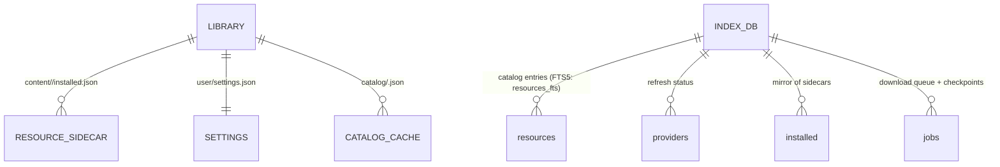

# Storage layout, file systems and data model

## Library layout (format version 1)

```
Arcana/                        ← library root; any folder works, "Arcana" at drive root is the default
├─ arcana-library.json         ← marker + identity (format, formatVersion, libraryId, label, createdAt)
├─ README.txt                  ← what each folder is (written at creation)
├─ Arcana.exe                  ← Windows program (release bundle)
├─ arcana.sh                   ← Linux/macOS launcher
├─ bin/<os>-<arch>/            ← programs per platform: arcana, kiwix/kiwix-serve(+DLLs)
├─ content/<resource-id>/      ← published resources (managed by Arcana)
│  ├─ installed.json           ← sidecar: commit point, provenance, file hashes
│  └─ <version>/<file>         ← the verified files
├─ staging/<job-id>/<file>.part← downloads in progress (safe to delete when Arcana is stopped)
├─ state/arcana.db (+-wal)     ← SQLite index (rebuildable cache)
├─ state/arcana.lock           ← OS-level lock (released automatically on crash)
├─ catalog/<provider>.json     ← last good catalog per provider (for offline browsing)
├─ index/documents.db          ← full-text index of documents (rebuildable cache)
├─ catalog/kolibri/<id>.sqlite3 ← Kolibri channel topic lists (classroom picker; refetched monthly)
├─ state/kolibri.json          ← the classroom: on/off, school, Kolibri administrator and password
├─ kolibri/                    ← Kolibri's own home (KOLIBRI_HOME): accounts, progress, imported courses
├─ user/                       ← never touched by content operations
│  ├─ settings.json            ← settings (unknown keys preserved)
│  ├─ bookmarks.json, favorites.json, recent.json (+ .bak previous copies)
│  ├─ notes/<id>.md            ← one Markdown file per note; notes/deleted/ keeps removed notes
│  ├─ documents/               ← the user's own files; .deleted/ keeps removed ones
│  └─ presets/user-*.json      ← saved collections
├─ manifest/library.json       ← portable description of installed resources (on request)
└─ logs/arcana.log             ← diagnostics (rotated at 5 MB)
```

| Area | Written by | If lost or damaged |
|---|---|---|
| `content/` + sidecars | Publisher (atomic) | Source of truth; integrity check reports, re-download or re-import |
| `staging/` | Download manager | Garbage-collected; partial download restarts |
| `state/arcana.db` | Index | Rebuilt from sidecars and catalog caches at next start |
| `catalog/` | Catalog refresh (atomic) | Bundled catalog still works; refresh when online |
| `user/` | User actions only | Back it up (Phase 2 export) |
| `kolibri/` | Kolibri only (ADR-0024) | Holds classroom accounts and progress: back it up; imported courses can be downloaded again |
| `bin/` | Release / app update (Phase 2, staged swap) | Re-copy from release |

### Portability rules

- **Paths.** Stored paths are relative to the resource directory, use
  forward slashes, and are re-validated on load. A sidecar cannot point
  outside its directory.
- **Names.** Resource IDs and file names are validated as portable names:
  ASCII-safe IDs (lower-case, so no case collisions on Windows/macOS); no
  `<>:"/\|?*`, control characters or leading dots; no trailing dot or
  space; no Windows device names (`con`, `aux`, `com1`…); at most 180
  bytes.
- **No host state.** Nothing essential lives in the host OS. Settings are
  on the drive. The browser keeps only the theme, the catalog language and
  the unsent selection.
- **Format versioning.** A build that finds a newer `formatVersion` opens
  the library **read-only** and explains why. Settings preserve keys they
  do not understand. The database schema uses `PRAGMA user_version`
  migrations, and a newer schema refuses to open rather than downgrade.

## File systems

| | exFAT | NTFS | FAT32 | ext4 | APFS |
|---|---|---|---|---|---|
| Windows | rw | rw | rw | needs WSL (no USB sticks) | third-party |
| macOS | rw | **read-only** | rw | third-party | rw |
| Linux | rw (kernel 5.7+) | rw (ntfs3 5.15+) | rw | rw | third-party |
| Max file size | 16 EiB | 16 TiB+ | **4 GiB − 1** | 16 TiB | 8 EiB |
| Journal | **No** (dirty bit only) | Yes | No | Yes | Yes (CoW) |
| Exec bit on Linux automount | follows umask (usually executable) | yes | `showexec`: ELF not executable | yes | — |
| Recommendation | **Default for portable drives** | Windows-only drives | Avoid (most archives > 4 GiB) | Dedicated appliance drive | Mac-only drives |

**exFAT has no journal.** Arcana compensates as follows:
1. Every metadata write is atomic: write a temporary file, fsync it, rename
   it, then fsync the directory.
2. Downloads are verified before publication, and a sidecar commit happens
   only after the files are in place.
3. SQLite is a rebuildable cache.
4. A full integrity check detects silent corruption.
5. The UI reminds users to eject safely.

Windows' default "Quick removal" policy (since 1809) disables write caching
on removable drives, which reduces exposure. Arcana warns about FAT32 and
NTFS on the dashboard, refuses files larger than the per-file limit at
enqueue, and opens read-only on read-only volumes (for example NTFS on
macOS).

## Durability model

- **Atomic replace.** `WriteFileAtomic` writes a temp file, fsyncs, renames
  and fsyncs the directory. On Windows the rename itself commits the
  directory change; directory fsync is unavailable there.
- **SQLite.** WAL journal with `synchronous=FULL`: committed transactions
  survive power loss on honest storage. `busy_timeout` is 10 s. A clean
  shutdown runs `wal_checkpoint(TRUNCATE)`, so a drive that moves between
  computers carries one file.
  - The database is never trusted beyond its role as an index: it is
    re-indexed from sidecars at every start. If `quick_check` fails, it is
    moved aside to `.damaged-<time>` and recreated.
  - Read-only libraries use an in-memory database built from the drive.
- **Download checkpoints.**
  1. Data is fsynced.
  2. Offset and serialized hash state are committed.
  3. On restart the file is truncated to the checkpoint.
  - Bytes written after the last checkpoint are never trusted.
- **Locks.** `flock`/`LockFileEx` on `state/arcana.lock`. A second Arcana
  on the same library opens read-only. Locks die with the process, so
  there are no stale lock files.
- **Drive wear.** Checkpoints happen every 16 MiB or 10 s rather than per
  buffer. Logs are modest and rotated. Nothing is written while only
  browsing, apart from the log line at start.

## Data model



- **`resources`:** id, provider, family, variant, title, category,
  `,lang,` list, version, published, download_size, format,
  redistribution, popularity, and `data` (the full JSON). Indexes on
  family, category and provider. FTS5 table `resources_fts(title,
  description, tags)` with `unicode61 remove_diacritics 2`; user input is
  reduced to quoted prefix terms, so FTS syntax cannot be injected.
- **`installed`:** resource_id, version, format, size, installed_at, and
  `data` (the sidecar JSON).
- **`jobs`:** id, resource_id, state, timestamps, and `data` (the job JSON,
  including resolved resource, file index, offset, hash state, validator,
  mirror index, bad mirrors, attempts, integrity failures (and whether one
  followed a download from several mirrors), next attempt, completed files,
  and the version it replaces).
- **`providers`:** id, name, fetched_at, resource_count, last_attempt,
  last_error.

**Sidecar (`installed.json`, format `arcana-installed-resource` v1).**
- The resource ID and version, the full normalized `Resource` at install
  time (so license, warnings and provenance travel with the content).
- The files, each with a relative path, size and SHA-256.
- Installation time and Arcana version.
- A verification statement, e.g. "sha256 matched the value published by
  kiwix", and an `unverified` flag.

## Portable manifest and transfer (implemented)

- **Library manifest.** `manifest/library.json` holds the library ID and
  label, then per resource the ID, version, files, SHA-256 and license
  summary. It is generated on demand and optionally signed with the
  library's Ed25519 key. Another installation can then recognize and
  validate a prepared drive without trusting its database.
- **Export.**
  1. Select resources.
  2. Arcana copies `content/<id>/` trees and sidecars to a target folder
     or drive.
  3. It writes the manifest and verifies the copies by re-hashing.
  - Restricted licenses are flagged before export.
- **Import.**
  1. Read the manifest.
  2. Skip resources already present with identical SHA-256 (no
     duplication).
  3. Copy the others into `staging/`, verify, then publish through the
     normal pipeline.
  - User data is never overwritten; `user/` content is merged by file
    name with conflict copies.
- **Offline update packages** use the same mechanism. A "sneakernet" drive
  carrying newer editions updates a disconnected library.
