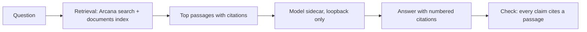

# O. Optional local question answering (design only)

Status: **design, not implemented.** The brief excludes local AI from the
MVP; this note records how it could be added later without changing
Arcana's guarantees.

## Goals and non-goals

- Answer questions in plain language **only from installed sources**, with
  citations a reader can open, and with visible uncertainty.
- Never required, never on by default, never a download Arcana starts by
  itself.
- Not a chatbot that knows things on its own: an answer without supporting
  passages is "I could not find this in your library".

## Architecture

- **Retrieval first.** Arcana already has full-text search over ZIM
  archives (kiwix-serve) and documents (SQLite FTS5), and the integration
  API returns plain text with citations. Passages are selected from those,
  not from model memory.
- **Model as a sidecar**, like kiwix-serve: a separate process (a
  llama.cpp-class server) installed as a catalog resource with its own
  license and checksum, started on loopback only, supervised, and stopped
  when unused. No native code is loaded into Arcana.
- **Interface**: a question box in Library search; answers show the passages
  used, each linking to the article, and the citation's warnings (medical,
  outdated) above the answer.

## Constraints to resolve before building

| Question | Notes |
|---|---|
| Hardware | Small models (1–4 B parameters, 4-bit) run on laptops and a Pi 5 slowly; answers may take tens of seconds. Measure before promising anything. |
| Licenses | Model weights carry their own terms; only openly licensed models that permit redistribution can be offered in the catalog. |
| Safety | Medical and legal questions must show the source warnings and recommend professional help where the source does. Refuse to answer beyond the passages. |
| Languages | Retrieval works per language; the model must handle the library's languages or say it cannot. |
| Evaluation | A fixed question set over the sample library, scored for citation correctness and refusal when the answer is absent. |

## Decision for now

No implementation. The integration API (v1) already lets an external tool
build this on top of Arcana without changing Arcana itself.
